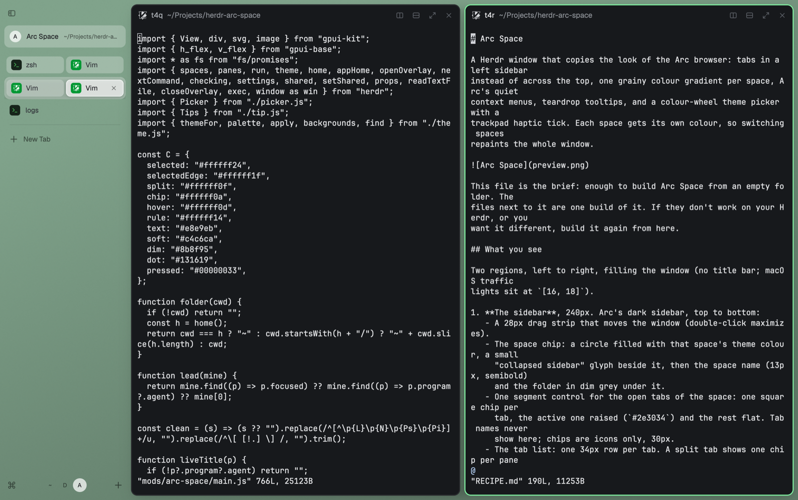

# Arc Space

A layout for [Herdr](https://herdr.dev) that looks like the [Arc](https://arc.net) browser: your tabs
in a left sidebar instead of along the top, one grainy colour gradient per space, Arc's quiet
context menus and teardrop tooltips, and a colour-wheel theme picker with a trackpad haptic tick.



## Why

Arc made the sidebar the place tabs live: vertical, quiet, one colour per space, and the chrome
gets out of the way. Working in Herdr I missed exactly that, so this layout brings it over — the
tab list becomes a sidebar, the tab strip on top disappears, and each space carries its own colour
so switching spaces *feels* like switching contexts.

## Features

- **Tabs in a sidebar.** One row per tab. A split tab shows one chip per pane — icon and title for
  two panes, icons only for three or more. The `×` appears on hover or focus.
- **A colour per space.** Each space gets a gradient (three layers: two-colour gradient, a tint, and
  optional grain), and the sidebar's text colours are picked by contrast against it. No theme means
  the layout's default deep green.
- **A theme picker.** Edit Theme Color… opens a 316×300 colour wheel: drag any dot and the group
  turns and scales together, `+` adds dots as a triad (up to three), plus three preset sets, an
  intensity wave and a noise dial that ticks under your fingers.
- **Arc's menus.** Right-click a tab: Separate All Tabs, Close Pane, Close Tab — or Add Split
  Terminal…, Rename Tab…, Close Tab for a single-pane tab. Right-click a space: Edit Theme Color…,
  Rename Space…, New Tab, Close Space.
- **Tooltips.** Dark teal pills with a teardrop corner and 3D key caps, 450 ms delay, pinned inside
  the hovered control; they go quiet while a menu is open.
- **A sidebar that slides.** `cmd+s` animates 240 → 0 in 11 steps, content pinned to the right edge;
  while collapsed the top-left pane header grows a toggle.
- **Motion that says what happened.** New tabs grow in, closed tabs collapse through a ghost row,
  and changing space staggers the rows in from the side of the new space (130 ms each, 14 ms apart).
- **The `cmd+t` bar.** Search tabs and agents, start an agent, or run a command, from one field.

## Install

Requires **Herdr 0.1.16** or newer.

Ask your Herdr agent to add `herdr.dev/layouts/eznix86/herdr-arc-space`.

By hand: copy `layouts/arc-space.json` and the four mod folders (`arc-space`, `arc-space-pane`,
`terminals-launcher`, `terminals-palette`) into `~/.config/herdr-app/`, merge the
`layout:arc-space` section of `keys.json` into yours, then:

```sh
herdr-app do layout.switch --name arc-space
```

`ctrl-shift-l` switches back to any other layout, and deleting the files removes it. Your own
layout and spaces are never touched.

## Quick start

1. `cmd+t` opens the launcher; type to filter tabs, start an agent, or run a command.
2. Right-click a space chip → **Edit Theme Color…**, drag a dot, and watch the whole window repaint.
3. Right-click a tab to rename it, close it, or merge another tab into it as a split.
4. `cmd+s` collapses the sidebar when all you want is the terminal.

## Keys

The layout binds these in `layout:arc-space`, so other layouts keep their own keys.

| Key | Action |
|---|---|
| `cmd+t` | Toggle the launcher |
| `cmd+shift+p` | Command palette |
| `cmd+s` | Collapse or expand the sidebar |
| `cmd+w` | Close the focused pane (not the tab) |
| `cmd+1..9` | Select tab N (silent if it does not exist) |
| `ctrl+1..9` | Select space N (silent if it does not exist) |

## Themes

Themes are per space, kept in Herdr's shared state under `arc-space.themes`:

```json
{ "dots": [{ "h": 137.5, "r": 0.318 }], "intensity": 0.81, "noise": 0, "mode": "dark" }
```

`h` is hue in degrees, `r` is 0..1 distance from the wheel's centre, `noise` 0..1 (a grain level
appears above 0.02), `mode` is `auto`, `light` or `dark`. A space with no saved theme gets the
default above — the deep green in the screenshot — with no grain. Themes are applied with
`layout.set`, so a theme change is a layout change: the file is rewritten each time.

## What it runs

Extensions run with your permissions, so: the picker starts `mods/arc-space/bin/haptic`, a small
compiled Swift helper (source is `haptic.swift`, rebuild with
`xcrun swiftc -O bin/haptic.swift -o bin/haptic`), only on macOS. It watches a file in the mod's
own folder and plays trackpad haptics; it exits when the picker closes or after 120 s idle.
Everything else is Herdr's own commands, plus `exec("herdr-app", ["do", …])` when a reply is needed
(`run()` returns nothing). It writes only inside `~/.config/herdr-app`, and reaches no network.

## Update

```sh
git -C ~/Projects/herdr-arc-space pull
```

then copy the changed files into `~/.config/herdr-app/` again (or re-add the gallery entry). Mods
hot-reload on save; `herdr-app status` shows load errors.

## Credits and license

The layout is a clone of the `terminals` layout that ships with Herdr, and the pane header a clone
of its `terminals-pane` mod; those parts keep Herdr's **Apache-2.0** license, as does the layout's
own `pane` icons copied into `mods/arc-space-pane/icons/`. The grain tiles are pre-tiled from the
`grain` asset inside Arc.app (`ARC_AskArc.bundle`) and are not redistributed from upstream. Icons in
`mods/arc-space/` are drawn for this build. **Apache-2.0**, Copyright 2026 Bruno Bernard — see
[LICENSE](LICENSE). Herdr ships no `NOTICE` file, so its Apache-2.0 terms plus the credit above are
what this repository carries.

## More

- [RECIPE.md](RECIPE.md) — the brief another agent could build this from, from an empty folder.
- Worked out while building: [Herdr's own guide](https://herdr.dev/guide) and the
  [gallery](https://herdr.dev/gallery) for other layouts and mods.
