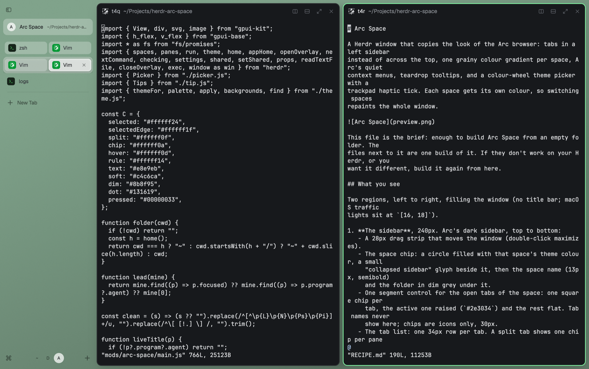

# Arc Space

A Herdr window that copies the look of the Arc browser: tabs in a left sidebar
instead of across the top, one grainy colour gradient per space, Arc's quiet
context menus, teardrop tooltips, and a colour-wheel theme picker with a
trackpad haptic tick. Each space gets its own colour, so switching spaces
repaints the whole window.



This file is the brief: enough to build Arc Space from an empty folder. The
files next to it are one build of it. If they don't work on your Herdr, or you
want it different, build it again from here.

## What you see

Two regions, left to right, filling the window (no title bar; macOS traffic
lights sit at `[16, 18]`).

1. **The sidebar**, 240px. Arc's dark sidebar, top to bottom:
   - A 28px drag strip that moves the window (double-click maximizes).
   - The space chip: a circle filled with that space's theme colour, a small
     "collapsed sidebar" glyph beside it, then the space name (13px, semibold)
     and the folder in dim grey under it.
   - One segment control for the open tabs of the space: one square chip per
     tab, the active one raised (`#2e3034`) and the rest flat. Tab names never
     show here; chips are icons only, 30px.
   - The tab list: one 34px row per tab. A split tab shows one chip per pane
     inside its row ("two panes: icon + title; three or more: icon only"). The
     active row is `#2e3034` at radius 8; hover is `#ffffff0d`.
   - `+ New Tab` at the bottom of the list, dim, 13px.
2. **The main card**, the rest. The active tab's terminals, each in a pane
   with radius 12, background `#17191c`, a 2px `#ffffff14` border that becomes
   a 2px ring in the space's theme colour when the pane has the keyboard, and
   a 28px header mod (program icon, title, split/zoom/close buttons). The whole
   card has a large shadow and radius 12; `terminal_opacity: 0` so terminals
   never paint square corners into the rounded pane.

Behind both: three stacked layers. A vertical-ish gradient from theme colour 1
to colour 2 (165°) on the root, then a `tint` layer with colour 3 fading out,
then, only when the space's noise is above 0.02, the grain: a 1512×950 noise
tile, `fit: "cover"`, at one of five levels. Padding 8 around everything, so the
gradient shows as a border. Grain is off by default.

Type is 15px in the panes (JetBrains Mono by default); panels are 12–13px.

## How it behaves

- **Keys** (`layout:arc-space`): `cmd+t` toggles the launcher, `cmd+shift+p`
  the command palette, `cmd+s` collapses/expands the sidebar, `cmd+w` closes
  the focused pane, `cmd+1..9` selects tab N and `ctrl+1..9` space N; both are
  silent when the target does not exist. `terminal` and `global` keep their
  own bindings.
- **Collapse** animates the sidebar 240 → 0 in 11 steps (~one per frame,
  ease-in-out); content is pinned to the right edge so it slides rather than
  squashes. While collapsed, the top-left pane header grows a sidebar toggle.
- **New tabs grow in**, closed tabs collapse through a "ghost" row that shows
  the tab name for the length of the animation, and changing space staggers
  the rows in from the side of the new space (130ms each, 14ms apart).
- **Right-click a tab:** a split tab offers Separate All Tabs, Close Pane (on a
  chip) and Close Tab; a one-pane tab offers Add Split Terminal… (picks
  another tab of the space to merge in), Rename Tab… and Close Tab.
- **Right-click a space** (address box, space circle, empty sidebar): Edit
  Theme Color…, Rename Space…, New Tab, Close Space.
- **Themes are per space**, in shared state `arc-space.themes`:
  `{ dots: [{h, r}] (max 3), intensity, noise, mode: "auto" | "light" | "dark" }`
  — `h` is hue in degrees, `r` is 0..1 distance from the wheel's centre. A space
  with no saved theme gets the layout's default look: one dot at hue 137.5°,
  `r` 0.32, intensity 0.81, no grain
  (`{ dots: [{ h: 137.5, r: 0.318 }], intensity: 0.81, noise: 0 }`) — the deep
  green of the preview. Noise runs 0..1 and only above 0.02 does a grain level
  appear (1..5). The theme sets the layout's three background layers, the
  sidebar's text colours (chosen by contrast against the gradient), and the
  focused-pane ring.
- **The theme picker** (from Edit Theme Color…): a 316×300 colour wheel. Drag
  any dot and the group turns and scales together; `+` adds a third dot as a
  triad. Three preset sets, an intensity wave, and an 84px noise dial that
  ticks with the trackpad. The wheel is applied with `layout.set`, so a theme
  change is a layout change.
- **Tooltips** on the pane header buttons and the sidebar's controls: dark teal
  pill with a teardrop corner and 3D key caps, 450ms delay, 120ms fade, pinned
  6px inside the hovered element's bottom-right. They go quiet while a menu is
  open (`arc-space.menu-open`).
- Agent status is **not** shown: the sidebar lists tabs, not agents.

## Built from

- **`layouts/arc-space.json`**, cloned from the shipped `terminals` layout
  (`"cloned_from": {"name": "terminals", "version": "0.1.16"}`). Root `column`,
  `"titlebar": "none"`, `"traffic_lights": [16, 18]`, `"theme": "graphite"`,
  `font_size: 15`, `terminal_opacity: 0`, its own `colors` block. Children:
  `tint` → `grain` (padding 8) → `row` of `sidebar` (`size: {px: 240}`,
  `content: {mod: "arc-space"}`) and `main` (`content: {tab: "active"}` with
  `radius 12`, `shadow: "lg"`, and the `pane` block: `radius 12`, `background
  #17191c`, `border 2px #ffffff14`, `focus 2px <theme>`, `header` from
  `arc-space-pane`). The theme code finds nodes by id (`tint`, `grain`,
  `sidebar`, `main`) — keep those ids.
- **`mods/arc-space/`** — the sidebar, and also every menu it opens. `place:
  "none"`, opened by the layout and as overlays with `props.view`:
  `"theme"` (the picker), `"menu"` (space menu), `"tab-menu"`, `"tab-pick"`.
  `init` reads `props().view` and returns early for the overlay copies.
  Overlay copies hand work back to the sidebar with
  `setShared("arc-space.job", spec); run("arc-space.job")`.
  Files: `main.js` (sidebar + menus), `theme.js` (colours, contrast, the three
  background layers, focus colour), `picker.js` (wheel, presets, wave, dial),
  `tip.js` (tooltips), `dial/0..23.svg` (handles) and `dial/wave-0..10.svg`
  (the intensity wave), `grain/grain-fine-1..5.png` (noise tiles, 1512×950,
  a 500×500 tile repeated because Herdr cannot tile images, made by
  `scripts/grain.mjs`),
  `bin/haptic` + `bin/haptic.swift`.
- **`mods/arc-space-pane/`** — the pane header, cloned from `terminals-pane`;
  adds the tooltips and the collapsed-sidebar toggle. `icons/*.svg` are copies
  of Herdr's shipped `pane` icons (Apache-2.0) so the mod carries its own art.
- **`mods/terminals-launcher/`** — the `cmd+t` bar: search tabs and agents,
  start an agent, run a command.
- **`mods/terminals-palette/`** — a restyled copy of Herdr's command palette
  (`frame/palette`). It shows its own `⌘T` label.
- **`keys.json`** — one section, `layout:arc-space` (see Keys above).
- **Commands called:** `pane.split`, `pane.close`, `pane.zoom`, `pane.focus`,
  `pane.go`, `tab.new`, `tab.close`, `tab.rename`, `tab.select`, `tab.move`,
  `space.new`, `space.close`, `space.rename`, `space.select`, `terminal.park`,
  `terminal.keep`, `terminal.peek`, `layout.set`, `layout.resize`, `mod.open`,
  `overlay.close`, `app.palette`.
- **Programs it runs:** `bin/haptic` (a compiled Swift helper — macOS only;
  the picker starts it while it is open and writes `quit` to
  `mods/arc-space/.tick` on close. It polls that file's mtime every 10ms and
  plays `NSHapticFeedbackManager.alignment` per change; it exits on `quit` or
  after 120s idle). Rebuild: `xcrun swiftc -O bin/haptic.swift -o bin/haptic`.
  It also calls back into the app with `exec("herdr-app", ["do", …])` because
  `run()` cannot return a reply.
- **Art:** all icons in `mods/arc-space/*.svg` are flat singles drawn for this
  build; the grain tiles are made by `node scripts/grain.mjs`: seeded white
  noise, white pixels whose alpha is a normal draw (mean 0.909, sd 0.318 of
  the level's peak, clipped), peaks 20/35/51/71/91 for levels 1..5.

## Watch out

- **Timers started inside `render` never fire.** Everything deferred goes
  through `this.later(ms, fn)`, a queue drained by a task started in `init`.
- **`run()` returns null.** To read a command's reply, use
  `exec("herdr-app", ["do", name, JSON.stringify(args)])`.
- **Moving a terminal between tabs has no single command:** `terminal.park`,
  wait 150ms, then `terminal.keep {place: "tab" | "right"}`. Calling `keep`
  immediately after `park` once killed the other terminal in the tab. Check
  the result before retrying. `keep {place: "right"}` splits next to the
  focused pane, so focus the target first.
- **`layout.set` rewrites the layout file.** The sidebar re-reads the file
  before every theme apply; any other code holding an old copy of the tree will
  overwrite edits.
- **Native gradients take exactly two colours**, which is why colour 3 needs
  its own `tint` node.
- **Background images are cached by path** — give a changed image a new file
  name. Images around 2400px failed to load; 1200–1512px work. Herdr cannot
  tile images, so the grain is pre-tiled per window size.
- **Pane frames ignore `shadow`**; the shadow belongs on the `main` block.
  Border width must be equal in the normal and focus states, or panes shift a
  pixel on every focus change.
- **Mods can only write under `~/.config/herdr-app`**, which is why the haptic
  helper watches a file in the mod's own folder.
- `herdr-app shot` lags: wait ~2s after a change before trusting a screenshot.
- `fs/promises.writeFile` keeps the file in place (the haptic helper can watch
  it); `writeTextFile` replaces it.
- **Limits:** 3 dots max per theme; 24 dial steps; 5 grain levels; the sidebar
  is 240 or 0, nothing in between.
- **Controls that do nothing yet:** `⌘`-hold number badges are drawn, but it is
  unverified whether the sidebar receives modifier events while a terminal has
  focus. The palette's `⌘T` hint is stale: `cmd+t` opens the launcher here.
- **Assumes:** macOS for the haptic ticks (elsewhere they are skipped).

## Done when

```sh
herdr-app check mods/arc-space          # passes: sidebar + every overlay view
herdr-app check mods/arc-space-pane     # passes: the pane header
herdr-app status                        # errors: []
```

Then, with the layout shown:

1. `layout.show`/`cmd+s` collapses the sidebar to 0 in a smooth 11-step slide
   and the pane header grows a toggle; `cmd+s` again brings it back to 240.
2. `cmd+t` opens the launcher; typing filters tabs; Escape closes it.
3. Right-click a space chip: the menu lists Edit Theme Color…, Rename Space…,
   New Tab, Close Space, in the dark popup 230px wide.
4. Edit Theme Color… → dragging a dot repaints the whole window (gradient,
   sidebar text and focus ring) while the picker is still open.
5. Raising the noise dial swaps the grain tile to the next level; the haptic
   helper ticks (macOS).
6. `cmd+1..9` and `ctrl+1..9` select tab and space N, silently when missing.
7. Test anything that creates, merges or closes tabs in a throwaway space
   (`herdr-app do space.new --name zz-test --focus false`), then close it.
